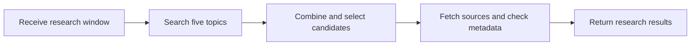
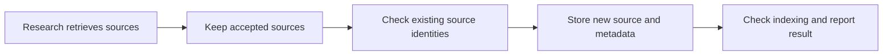

# Weekly Research and Knowledge Publishing: research workflow spec

## Goal and scope

Document the existing Research Agent's nodes with short, accurate descriptions visible in Dify. Preserve its behavior, connections, configuration, and draft layout. This change does not implement knowledge-base ingestion.

App: Weekly Research and Knowledge Publishing (`7c62ae56-b3c5-4a47-a25f-c85281788561`). Mode: Workflow, because it runs once from inputs to outputs.

## Requirements

- R1 (feature): Explain each existing Research Agent node in plain language, based on its actual behavior. Step: Document nodes.
- R2 (rule): Do not change execution behavior, configuration, connections, or the existing draft's layout. Step: Preserve workflow.
- R3 (rule): Do not claim that sources are stored in a knowledge base: the inspected workflow currently has no ingestion node. Step: Document outputs.

## Inputs and outputs

- Inputs: required as-of date (YYYY-MM-DD) and research window in days (1–31).
- Outputs: the inputs, combined search candidates, selected sources, and the retrieval iteration's results.

## Process

## Existing nodes and proposed explanations

- Research inputs: Accept the as-of date and research window.
- Prepare dated research queries: Validate the date and window and build one search query per topic.
- Search AI research / Search science / Search healthcare / Search astronomy / Search technology: Search DuckDuckGo for up to five results for the respective topic.
- Validate and combine search results: Normalize and deduplicate valid search results across topics.
- Research agent: rank and select sources: Ask the model to score candidates and select up to ten sources with roles.
- Check research selection: Validate the model's JSON, source URLs, topics, roles, scores, and selection limit.
- Record retrieval date (UTC): Get the current UTC date for source metadata.
- Retrieve selected sources: Process the selected sources sequentially, continuing on iteration errors.
- Iteration start: Begin processing the next selected source.
- Check source URL: Validate and normalize the selected source's URL.
- Fetch public source: Fetch the selected URL with the web scraper.
- Extract source metadata: Ask the model to extract the title, publication date, date quote, and DOI from the fetched text.
- Verify metadata and recency: Check extracted fields against the fetched text and apply the date window to main stories and highlights; return accepted or rejected metadata.
- Prototype skeleton output: Return inputs, candidates, selected sources, and retrieval results.

## Acceptance cases

- A1 (exact; R1): Every existing node has a concise description matching the behavior above, including the iteration start if supported by Dify.
- A2 (exact; R2): Compare the edited workflow with the chosen baseline; only node descriptions may differ.
- A3 (exact; R3): Descriptions and output analysis do not assert that sources are ingested into a knowledge base.
- A4 (exact; R2): Run Dify's DSL check on the edited workflow and report any pre-existing warnings or errors.

## Resources and open decisions

- Uses the app's existing DuckDuckGo, web scraper, time, and Ollama configuration; no new resources are requested for this documentation change.
- The existing draft and current published version have the same node data and connections, but differ in canvas layout and edge metadata. Proposed baseline: the draft, preserving its layout; confirmation is required by the workflow-change procedure.
- Knowledge-base ingestion is absent. Its design and implementation are outside this documentation change and require separate work.

## Change: store research sources (proposed 2026-11-11)

### Goal and scope

Extend the existing Research Agent so accepted, fetched public sources are stored in `weekly-research-database` for subsequent retrieval. A source accepted here has passed the existing source-metadata and recency checks; this does not mean its claims have been independently validated. Preserve the existing research behavior and visible canvas notes.

### Requirements

- S1 (feature): Store each accepted source's fetched text in the existing knowledge base and retain the title, source URL, retrieval date, topic, publication date and DOI when available. Steps: Prepare and store source.
- S2 (rule): Never store a rejected source or fabricate missing metadata. Step: Filter accepted sources.
- S3 (rule): Avoid creating another document for a previously stored source identified by normalized URL or DOI; do not assume incomplete document listings are complete. Step: Check existing sources.
- S4 (failure): Clearly report document creation, metadata or indexing failures; do not report an accepted write as indexed until the knowledge base confirms it. Steps: Store source and check indexing.
- S5 (rule): Keep credentials secret and leave the existing knowledge-base documents intact. All information stored must come from public sources. Step: All storage steps.
- S6 (feature): Add visible canvas comments explaining new workflow nodes. Step: Document workflow.

### Process

### Acceptance cases

- S-A1 (exact; S1, S5): An accepted public source is stored with its text and available metadata, and can be retrieved after indexing; existing documents remain intact.
- S-A2 (exact; S2): Rejected or empty sources do not create documents.
- S-A3 (exact; S3): Re-running with an existing URL or DOI does not create another copy, including when the matching entry is on a later document-list page.
- S-A4 (exact; S4): Failed document creation, metadata assignment, or indexing produces an explicit failure rather than success; a pending index remains pending.
- S-A5 (exact; S5): No credentials appear in exported workflow YAML or repository files.
- S-A6 (exact; S6): New workflow nodes have visible note cards that explain them.

### Resources and open decisions

- Existing Dify knowledge base: `weekly-research-database` (`f459de88-bfd5-4bc3-a477-12c1241010fc`), high-quality indexing; it currently contains one document with source metadata. An embedding model and a local Knowledge API credential are configured; the credential has read access to this knowledge base.
- No installed workflow tool for creating knowledge-base documents was found. Candidate: the community Knowledge Pro tool, which advertises document creation and metadata operations; it is not installed and requires confirmation and configuration. Its pagination, indexing-status and duplicate-handling capabilities still need inspection and tests.
- Alternative: Dify's Knowledge API directly. It avoids a new plugin but would require workflow/API integration and careful handling of pagination, indexing and failures. The environment's API key is configured locally; network access from the Dify runtime has not yet been verified.
- Integration choice and exact failure handling remain open. Concurrent runs require serialization or another demonstrated safe mechanism; do not claim atomic deduplication without one.
- No knowledge-base content has been modified by this investigation.

### Decision

The user selected the Dify-only approach on 2026-11-11: operate one research run at a time. This operational requirement does not guard against concurrent writes by other apps, direct API clients, or racing requests. Knowledge Pro was installed and configured at the user's direction.
