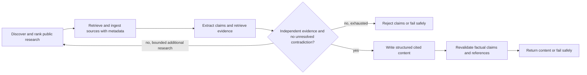

# Weekly Research and Knowledge Publishing Agent: spec

Status: approved by the user on 2026-11-08. The research-only Workflow (app ID `7c62ae56-b3c5-4a47-a25f-c85281788561`) has a published version and an incomplete draft. A five-topic draft run succeeded on 2026-11-10 after earlier astronomy-search failures. A knowledge base has been created by the user and initialized; a scoped proxy rule permits its Knowledge API route. Workflow-triggered ingestion has not been built or tested. The user instructed us to preserve their Dify server changes and use the current draft as the baseline.

## Goal and mode

Create a Dify Workflow that researches recent public developments, validates claims against independent evidence, and returns structured, cited content for a later website generator. Workflow mode fits a single run with structured inputs and outputs. Scheduling, website deployment, email, application publication and Git pushes are out of scope.

## Requirements

- R1 (feature): Discover recent AI, science, healthcare, astronomy and technology developments; rank by relevance, novelty, credibility and reader interest, and select a main story and secondary highlights. Step: research.
- R2 (feature): Retrieve public source material and ingest newly discovered sources into the persistent `weekly-research` knowledge base. Step: research and ingestion.
- R3 (rule): Use semantic indexing, approximately 500-token chunks with small overlap, and initial retrieval top-k 5. Preserve title, URL, publication date, retrieval date, topic and DOI when available; avoid duplicate documents and support historical retrieval. Step: ingestion and evidence retrieval.
- R4 (feature): Extract important claims and retrieve supporting knowledge-base evidence. Step: validation.
- R5 (rule): Require at least two independent, trusted sources per important claim; separate reports of the same study do not constitute independent confirmation. Detect contradictions. Step: validation.
- R6 (failure): Request additional research within a bounded feedback process or reject unsupported and contradicted findings. Fail safely when adequate evidence cannot be obtained. Step: validation and routing.
- R7 (feature): Generate an article, weekly highlights, a topic-appropriate visual concept and structured web-ready output from validated claims, with source references. Revalidate any factual claims introduced during writing. Step: content and final validation.
- R8 (rule): Prefer deterministic routing, processing and validation; keep the design simple and token consumption low. Preserve traceable sources and never invent facts or citations. Step: all stages.
- R9 (rule): Save the workflow DSL and setup instructions in the repository, without credentials or private data. Keep skill working files. Step: handover.
- R10 (failure): Validate the DSL and test real public-source research, ingestion, semantic retrieval, rejection of unsupported claims and referenced output. Report failures and blockers rather than simulating success. Step: verification.
- R11 (rule): Do not alter unrelated applications, delete existing resources, publish applications, push Git changes, or implement scheduling, deployment or email. Step: all stages.

## Inputs and outputs

- Inputs: a run date or research window; any additional controls are to be settled during planning.
- Outputs: structured article, highlights, visual concept, source references, validation decisions and failure status sufficient for a downstream website generator. Exact schema will be specified in the plan.

## Process

## Acceptance cases

- A1 (judged, R1–R5, R7–R10): A recent real public topic has two independently corroborating trusted sources. The run ingests and retrieves them, selects a main story, and returns structured content with traceable references. Inspect source content and the independence of the underlying evidence.
- A2 (exact and judged, R4–R6, R10): A fabricated or unsupported important claim has no independent corroboration. It is rejected or the run fails safely; it must not appear as fact in the article or highlights.
- A3 (exact and judged, R3–R6, R10): Two outlets report the same underlying study. They do not count as two independent confirmations; conflicting or insufficient evidence is rejected or requests bounded research.
- A4 (exact, R2–R3, R10): Ingest the same source twice, then retrieve it semantically. Verify only one document is retained, with required available metadata, and it appears in retrieval results.
- A5 (exact and judged, R6–R8, R10): Search, ingestion, retrieval or a model fails, or evidence is empty. No unsupported article is returned as validated; an actionable failure is visible.
- A6 (judged, R7–R9): A writer introduces a new factual claim or invalid reference. The final check rejects it unless independently validated; exported files contain no credentials.
- A7 (exact, R11): Existing applications remain unchanged; the new application remains an unpublished draft and no Git push occurs.

## Resources and choices

Workspace inspected on 2026-11-08: `9c1ca568-a656-475e-8a8c-f410589f62b1`. One unrelated existing application and the user-created knowledge base are present.

- Language model: installed and active Ollama `qwen3.5:27b` (`langgenius/ollama/ollama`); candidate, subject to testing.
- Web discovery: user approved Dify/LangGenius DuckDuckGo; version 0.0.14 is installed and its search tool is marked configured, but has not been run. Alternatives shown: Dify/LangGenius Tavily (460,389 marketplace installs at initial inspection) and Google (222,364); provider credentials may be required. Installed Web Scraper can retrieve a known URL, but cannot itself discover topics.
- Embeddings: Ollama `qwen3-embedding:0.6b` is active in Dify, configured by the user. A public-source test document was indexed and retrieved semantically; workflow-node retrieval remains untested.
- Knowledge base: the user created `weekly-research-database`, ID `f459de88-bfd5-4bc3-a477-12c1241010fc`; the name differs from the originally requested `weekly-research`. It has been initialized with high-quality indexing, `qwen3-embedding:0.6b`, and semantic top-k 5. A single public NASA test document was indexed with a 500-token limit and 50-token overlap; semantic retrieval returned its content. Six metadata fields were defined and available source metadata was verified on the test document. The test document alone does not meet independent-corroboration requirements. The local Knowledge API key works; a scoped proxy rule now allows authenticated access to this dataset via `http://nginx/v1/datasets/f459de88-bfd5-4bc3-a477-12c1241010fc` from Dify's worker. Workflow-triggered ingestion remains untested.
- Ingestion, deduplication and factual independence: exact supported implementation and guarantees require investigation during the approved plan; source count alone cannot prove independent evidence.

## Open questions

- Test DuckDuckGo source discovery and the embedding model in a workflow and knowledge base.
- Test workflow-triggered ingestion through the scoped Knowledge API route; the host's loopback address cannot be assumed reachable from a container.
- Resolve feasibility of automatic ingestion, metadata persistence, deterministic duplicate checks and independent corroboration before approving a node-level plan. Do not weaken the stated requirements silently.
